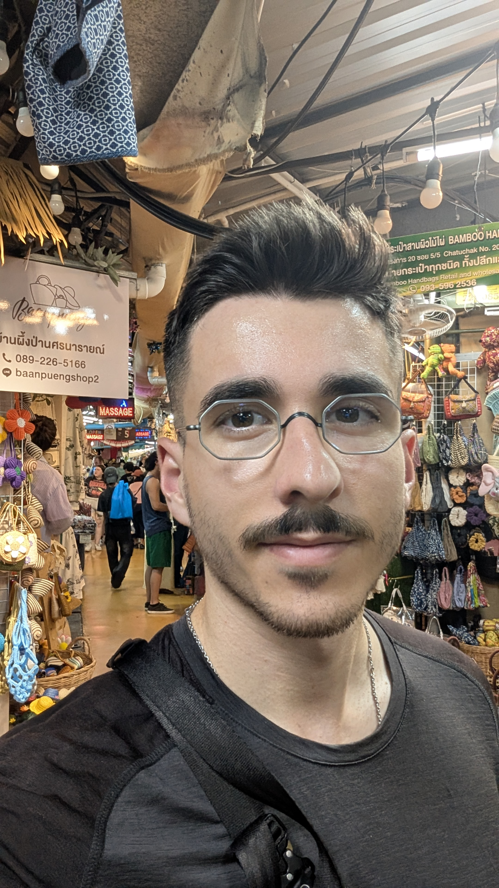
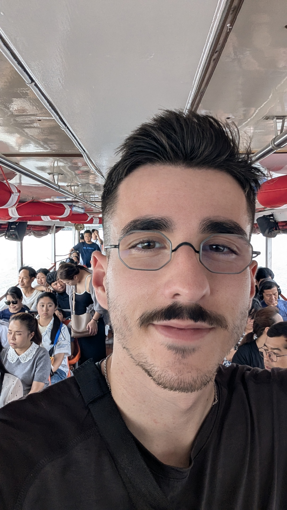
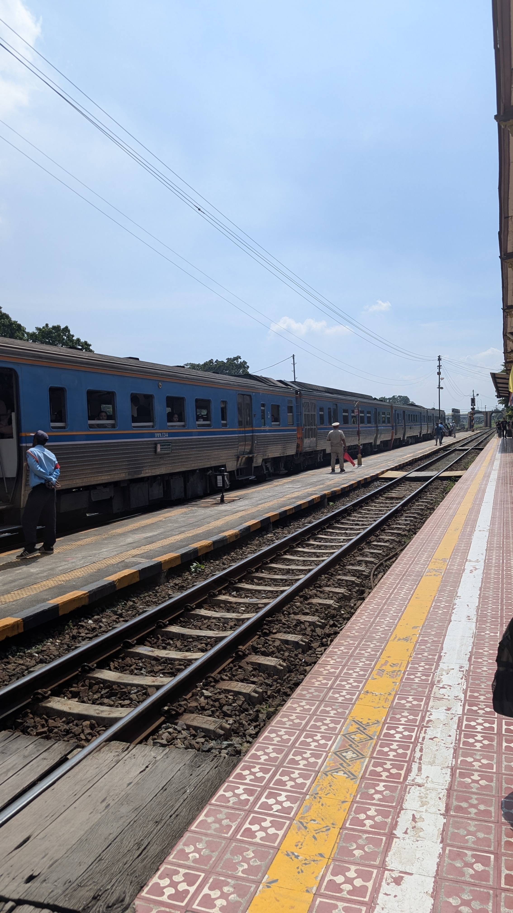
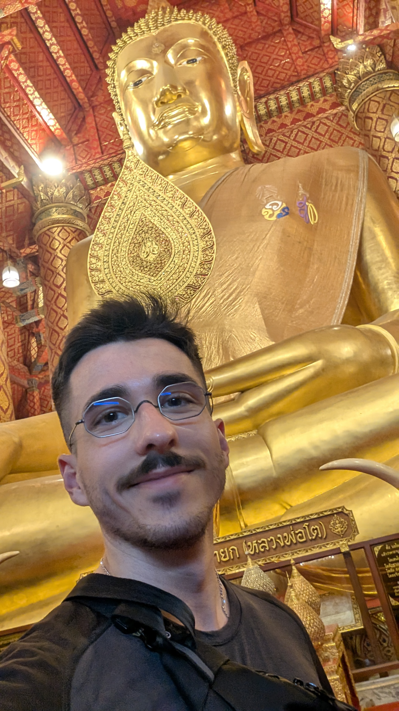
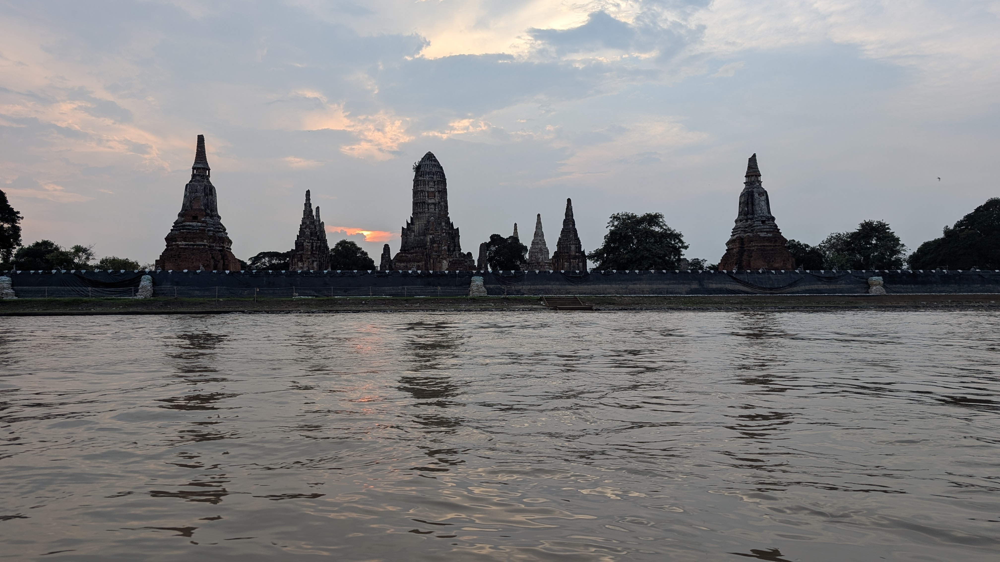
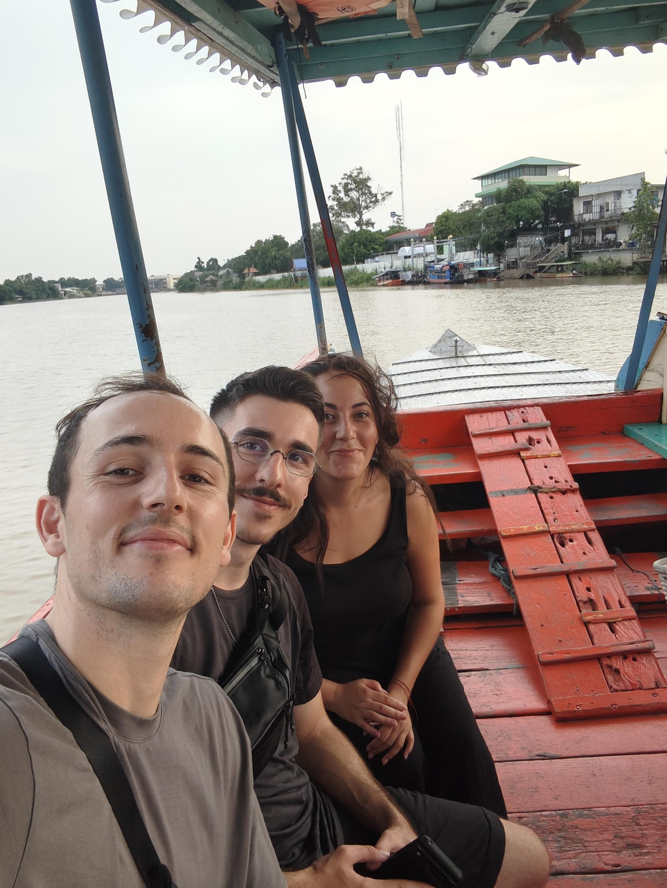
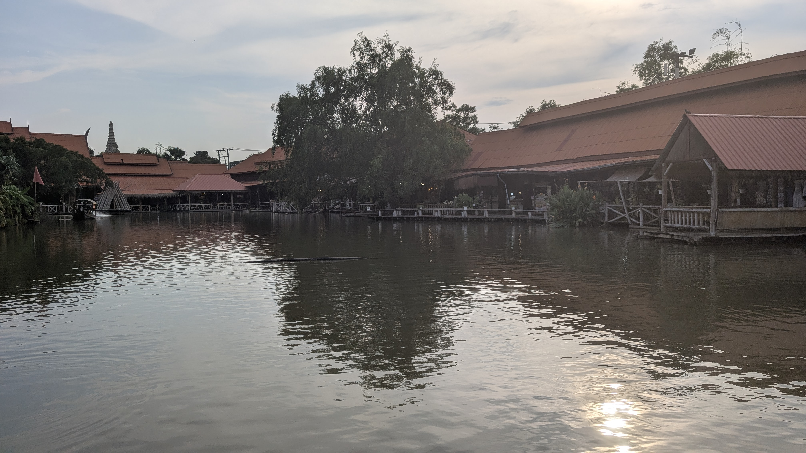
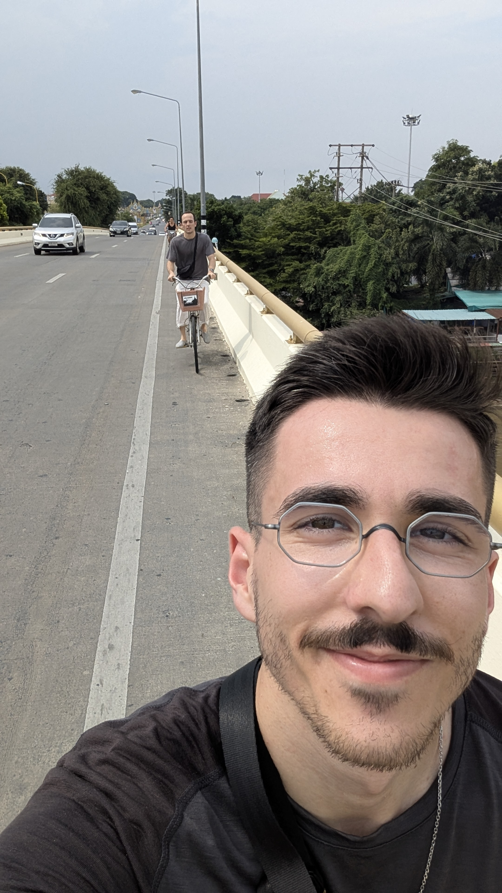

# Bangkok 
### *(14/11/26 - 15/11/26)*
Je doit dire que la seule journée complète que j'ai passé dans la capitale (arrivé de nuit le 14) à été teinté de surcharge mentale, trop de nouvelles choses, si peu de repaire...

J'ai tous de même pû avoir un premier regard sur la ville, à travers le Chatuchak Weekend Market, un moment en bateau, mon premier Grab (Uber local) et une pluie torrentielle en milieu d'après midi :)

Mais, j'ai vite pris la décision de quitter cette ville trop grosse pour moi (pour le moment) pour me diriger vers l'ancienne capitale Ayutthaya !

# Ayutthaya 
### *(16/11/26 - 17/11/26)*

C'est après une heure de train en troisième classe, que j'arrive dans cette petite ville.

Ville très différente de Bangkok, on sent la campagne, plus vraiment de trottoirs, plus vraiment de touristes, bien plus d'authenticité d'après moi.

Je me suis posé à l'auberge [Early Bird](https://hostelworld.onelink.me/Jqot/hhdosb6l?deep_link_sub9=sharing_ota_272776&deep_link_sub10=aHc6Ly9zL3B5LzI3Mjc3Ng==&af_web_dp=https%3A%2F%2Fwww.hostelworld.com%2Fst%2Fhostels%2Fp%2F272776%2FEarly-Bird-Hostel-Ayutthaya%2F%3Fsource%3Dapp_shared_property-272776), ou j'ai rencontré un groupe de backpacker avec qui ont à pu partager des moments tout au long de mon séjour dans cette ville.

Mon premier temple, une balade de bateau autour de la ville, le Night Market, le Floting Market... Mais aussi du velo ! 

Après ces deux superbe journée et des discussions le soir devant l'auberge, j'ai l'impression d'avoir fait le tour de cette petite ville et je prends un bus de nuit vers Chang Mai.

# Chang Mai
### *(18/11/26 - ?)*

*To be continued...*

