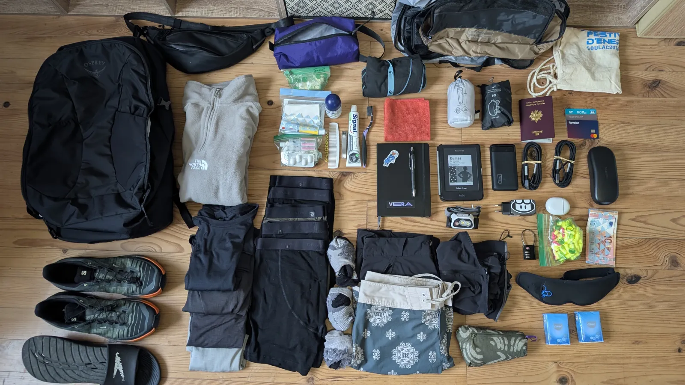
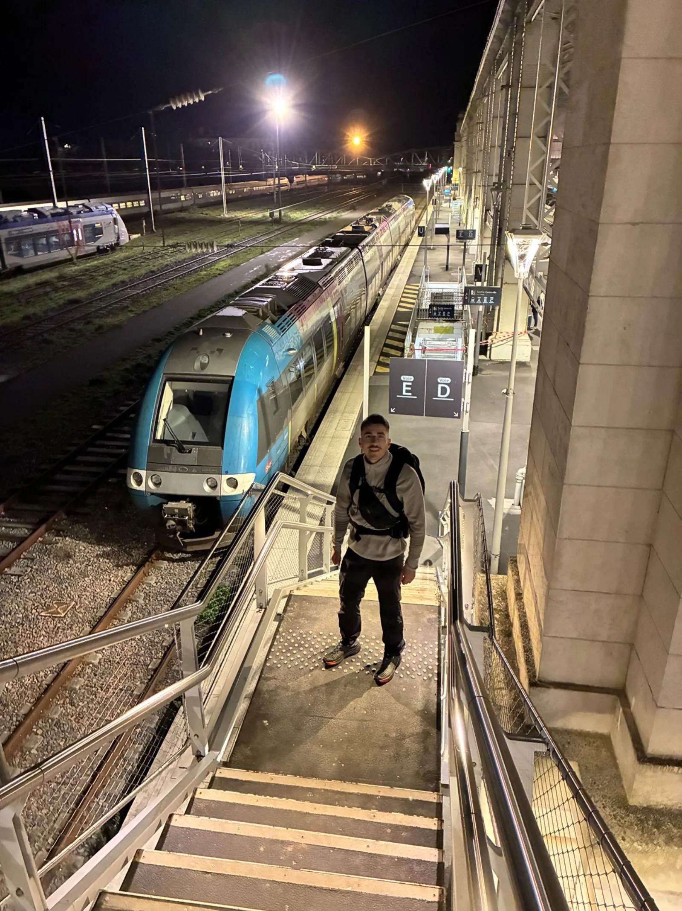

# Le projet

Pour mon premier voyage solo, j'aspire à decouvrir le monde, apprendre de toutes les expériences, faire des rencontres, le tout sans organisation préalable. Je pars aujourd'hui et je n'ai prévu que mes deux premières nuits en auberge à Bangkok, le reste "reste à faire" :) 
Pas de date retour.

Cependant la ligne directrice, toute fine soit elle, c'est le [Banana pancake trail](https://fr.wikipedia.org/wiki/Banana_Pancake_Trail).

# Mon équipement

### Liste

* Sac à dos Osprey Farpoint 40L
* Sac à dos pliable 10L
* Sac banane 3L
* Tote bag à cordons
* 3 cubes de compression
* Trousse de toilette
* Coupe-vent
* Polaire
* Pantalon convertible en short
* Short de bain
* 4 t-shirts en mérinos
* 5 boxers en mérinos
* 3 paires de chaussettes en laine
* Chaussures de trail Salomon Genesis 2
* Claquettes
* Liseuse Kobo Clara BW
* Batterie externe 20 000 mAh
* Frontale
* Écouteurs bluetooth
* Adaptateur secteur 65W
* 2 câbles de recharge
* Serviette microfibre
* Brosse à dents et dentifrice
* Déodorant
* Peigne
* Coupe-ongles
* Kit médicaments et pansements
* Stock de bouchons d'oreilles
* Drap de sac
* Masque de sommeil
* Cadenas
* Passeport
* 3 cartes bancaires
* 140€ (billets)
* Carnet et stylo
* 2 paires de lunettes avec étui

Pas de superflu, à mon sens en tout cas. 5.5kg sac compris.

#  Le départ 

Le 13/11/2026 réveil à 4h40, TGV vers l'aéroport CDG et direction Bangkok :)

*To be continued...*

